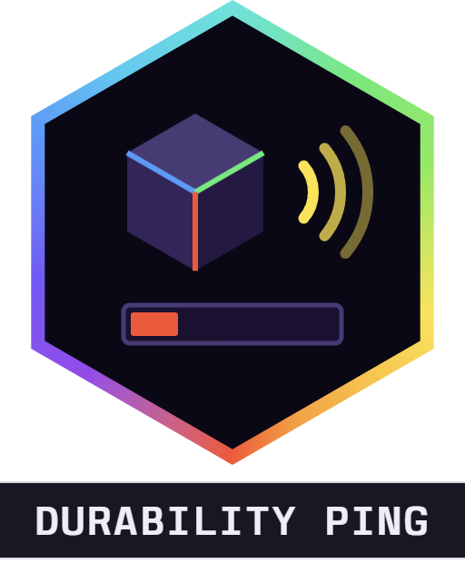

<div align="center">



# Alaydriem's Durability Ping

[](https://github.com/alaydriem/amml-durability-ping/releases)
[](https://github.com/alaydriem/amml-durability-ping/actions/workflows/build.yml)
[](./LICENSE)

[](https://github.com/alaydriem/amml)

</div>

A tone when the tool in your hand is low on durability, and an optional guard that stops you from using it before it breaks.

Client-side only. The tones are made by the mod, so it ships no sound files.

## Features

- **Alert** (on by default). One tone plays when a tool goes below the alert limit, or the first time you hold a low tool. Switching back to a tool you were already warned about is silent. The tone plays again only after the tool is repaired above the limit. While a menu or the loading screen shows, the tone waits until the screen closes.
- **Guard** (off by default). A tool below the guard limit does not work: no mining, no hits, no bow or fishing rod, and no tool use on a block (hoe, axe, shovel, flint and steel, shears). A low tone plays at most once a second while you try. A right-click on a chest, door, lever or crafting table still works.
- Hold <kbd>Alt</kbd> to use a guarded tool. The key can be changed on the mod manager's Keybinds page.

Only the main hand is checked. The tones play through the Windows volume mixer entry for Minecraft, not the in-game sliders.

## Installation

Install it with the [AMML launcher](https://github.com/alaydriem/amml/releases/latest). The launcher also installs the AMML loader and Alaydriem's Mod Manager, which this mod needs.

## Configuration

Settings are in the mod manager panel (<kbd>Ctrl</kbd> + <kbd>Shift</kbd> + <kbd>F10</kbd>) and saved to `mods/amml/@amml/durability-ping/config/config.hcl`. Changes apply at once.

| Setting | Default | Description |
| --- | --- | --- |
| `alert.enabled` | `true` | Play the alert tone |
| `alert.percent` | `10` | Alert below this percent of durability left (0–100; `0` turns this part off) |
| `alert.uses` | `20` | Alert below this many uses left (0–2000; `0` turns this part off) |
| `alert.volume` | `60` | Tone volume (0–100, step 5) |
| `block.enabled` | `false` | Guard low tools |
| `block.percent` | `2` | Guard below this percent left (0–100) |
| `block.uses` | `3` | Guard below this many uses left (0–2000) |
| `keys.override` | `"Alt"` | Hold to use a guarded tool |

A tool is low when either part is met, whichever comes first. If both parts of a limit are `0`, that limit is off.

## Building

Requires Windows x64, [mise](https://mise.jdx.dev), rustup and [cargo-nextest](https://nexte.st).

```powershell
mise trust
mise run preflight
mise run package
mise run test
```

## License

BSD 3-Clause. Copyright (c) 2026 Charles R. Portwood II. See [LICENSE](./LICENSE).
